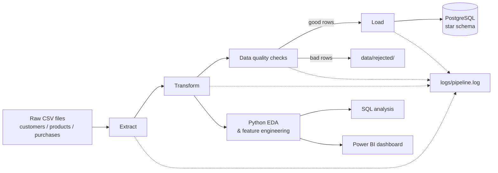

# Customer Behaviour Analysis: Data Pipeline & Analytics

An end-to-end retail data project in two parts:

1. **Data Engineering:** an automated Python ETL pipeline that extracts raw CSV files, cleans and validates them, and loads them into a **PostgreSQL star schema**.
2. **Data Analytics:** exploratory analysis in **Python**, business queries in **SQL**, and an interactive **Power BI** dashboard that answer practical retail questions. Which categories and age groups drive revenue? Do subscribers spend more? Are discounts actually used? Which customers are loyal?

Customer Behaviour Dashboard


---

## Architecture



---

# Part 1: Data Engineering

## The pipeline

| Stage | File | What happens |
|---|---|---|
| Extract | `etl/extract.py` | Reads 3 source CSV files; fails with a clear message if one is missing |
| Transform | `etl/transform.py` | Standardizes column names, fills 37 missing ratings with the category median, adds `age_group`, `customer_segment`, and `purchase_frequency_days` |
| Quality checks | `etl/quality.py` | 12 checks (nulls, duplicates, valid ranges and values, foreign-key matches). Bad rows are saved to `data/rejected/` with the reason; the run stops if more than 5% of a table fails |
| Load | `etl/load.py` | Loads dimension tables first, then the fact table, using the IDs PostgreSQL generates. Safe to re-run: tables are truncated first, so there are no duplicates |
| Logging | `etl/logger.py` | Writes every step, warning, and error to the screen and to `logs/pipeline.log` |
| Orchestration | `run_pipeline.py` | Runs all stages in order, logs timings, and exits with an error code on failure |

The database password is read from an environment variable (`DB_PASSWORD`) or typed at run time, never stored in the code.

## Data model (star schema)

```
dim_customer ─┐
dim_product  ─┼──►  fact_purchases
dim_shipping ─┘
```

| Table | Type | Contents |
|---|---|---|
| `fact_purchases` | Fact | One row per purchase: amount, rating, size, color, season, discount, promo code, payment method |
| `dim_customer` | Dimension | Age, gender, location, subscription status, age group, customer segment |
| `dim_product` | Dimension | Item and category |
| `dim_shipping` | Dimension | Shipping type |

Table definitions: [`sql/create_tables.sql`](sql/create_tables.sql)

Example query against the warehouse:

```sql
SELECT p.category, ROUND(SUM(f.purchase_amount_usd), 0) AS revenue
FROM fact_purchases f
JOIN dim_product p ON f.product_id = p.product_id
GROUP BY p.category
ORDER BY revenue DESC;
```

---

# Part 2: Data Analytics

## Key findings

Based on 3,900 purchase records totalling **$233,081** in revenue (average purchase: **$59.76**).

- **Revenue by category:** Clothing is the top earner at **$104,264 (44.7%)** of total revenue, followed by Accessories (31.8%), Footwear (15.5%), and Outerwear (7.9%).
- **Age groups:** revenue is spread almost evenly. Young Adults (18-31) lead slightly at **26.7%**, while the other three age bands each contribute 24-25%.
- **Subscribers vs. non-subscribers:** subscribers do **not** spend more. Average purchase is $59.49 for subscribers vs. $59.87 for non-subscribers, and only 27% of customers (1,053) are subscribed. This points to an opportunity to improve the value of the subscription offer.
- **Discounts:** **43%** of purchases used a discount. Hats (50%), Sneakers (49.7%), and Coats (49.1%) have the highest discount usage.
- **Customer segments:** **79.9%** of customers are Loyal (more than 10 previous purchases), 18.0% are Returning (2-10), and only 2.1% are New.
- **Top-rated products:** Gloves (3.86), Sandals (3.84), and Boots (3.82) have the highest average review ratings.
- **Gender:** male customers account for 67.7% of revenue.

**Business takeaway:** revenue is concentrated in Clothing and Accessories (about 77%), and spend is nearly flat across age groups and subscription status. Growth is more likely to come from retaining the large loyal base, making subscriptions more valuable, and recruiting new customers than from targeting a particular age group.

## Analysis workflow

**Python: cleaning and EDA**
- Checked structure, data types, and missing values; standardized column names and types
- Engineered features: age groups, purchase frequency in days, customer segments
- Explored spending, ratings, categories, and subscriptions

**SQL (PostgreSQL): business analysis** (`customer_behaviour.sql`)
- Revenue by gender and by category
- Average customer spend
- Top-rated products
- Discount usage by product
- Subscriber vs. non-subscriber spending
- Top products by purchase volume
- Customer segmentation
- Revenue contribution by age group

**Power BI: dashboard**
- KPI cards: total revenue, total customers, average purchase amount
- Revenue by category and by age group
- Customer segments, subscription analysis, product performance, and discount trends
- Interactive filters

---

## Dataset

Source file: `customer_shopping_behavior.csv`. 3,900 records and 18 columns, where each row is a customer purchase.

| Area | Fields |
|---|---|
| Customer | age, gender, location, subscription status, previous purchases, purchase frequency |
| Purchase | item, category, purchase amount, size, color, season, payment method |
| Behaviour | review rating, discount applied, promo code used, shipping type |

Review Rating has 37 missing values, which are handled in the transform step.
<!-- TODO: add the data source link (e.g. Kaggle) if applicable -->

---

## Tech stack

| Area | Tools |
|---|---|
| Data engineering | Python, Pandas, SQLAlchemy, psycopg2, PostgreSQL, Windows Task Scheduler |
| Analytics | Python (Pandas, NumPy, Matplotlib, Seaborn), SQL, Jupyter Notebook, Power BI |
| Other | Git, GitHub |

---

## Project structure

```
Customer_Behaviour_Analysis/
├── data/raw/                  # source CSV files (created by split_csv.py)
├── etl/
│   ├── extract.py
│   ├── transform.py
│   ├── quality.py
│   ├── load.py
│   └── logger.py
├── sql/
│   └── create_tables.sql      # star schema definition
├── split_csv.py               # splits the original dataset into 3 source files
├── run_pipeline.py            # runs the whole pipeline
├── run_pipeline.bat           # launcher for Task Scheduler
├── requirements.txt
├── DA Project (shopping analysis) (1).ipynb   # Python cleaning, features, EDA
├── customer_behaviour.sql                     # SQL business analysis
├── customer_behaviour_dashboard.pbix          # Power BI dashboard
├── customer_shopping_behavior.csv             # original dataset
├── LICENSE
└── README.md
```
<!-- TODO: confirm the .pbix and notebook file names match your repo -->

Generated at run time and not stored in the repo: `logs/`, `data/processed/`, `data/rejected/`.

---

## How to run

### The ETL pipeline

**1. Clone and install**
```bash
git clone https://github.com/ashoo07/Customer_Behaviour_Analysis.git
cd Customer_Behaviour_Analysis
pip install -r requirements.txt
```

**2. Create the source files**
```bash
python split_csv.py
```

**3. Create the database**
Create a database named `customer_dw` in PostgreSQL, then run `sql/create_tables.sql` in it.

**4. Set the database password**
```bash
setx DB_PASSWORD "your_password"
```
Open a new terminal afterwards. If the variable isn't set, the pipeline asks for the password when it runs.

**5. Run the pipeline**
```bash
python run_pipeline.py
```
Add `--no-load` for a dry run that skips the database step. To run it daily, point Windows Task Scheduler at `run_pipeline.bat`.

### The analysis

1. Open the notebook and run the cells in order to reproduce the cleaning and EDA.
2. Run `customer_behaviour.sql` in PostgreSQL to reproduce the SQL analysis.
3. Open the `.pbix` file in Power BI Desktop, update the data source if prompted, and refresh.

---

## Skills demonstrated

**Data engineering:** ETL design · Python scripting · Star schema modelling · PostgreSQL · Data quality validation · Error logging · Pipeline automation

**Data analysis:** Data cleaning · Feature engineering · Exploratory data analysis · SQL · Customer segmentation · Dashboard design · Business storytelling

---

## Possible next steps

- Orchestrate with Apache Airflow
- Add incremental loading instead of a full reload
- Add unit tests for the transform and quality functions
- Connect the Power BI dashboard directly to the star schema

---

## License

Released under the [MIT License](LICENSE).
